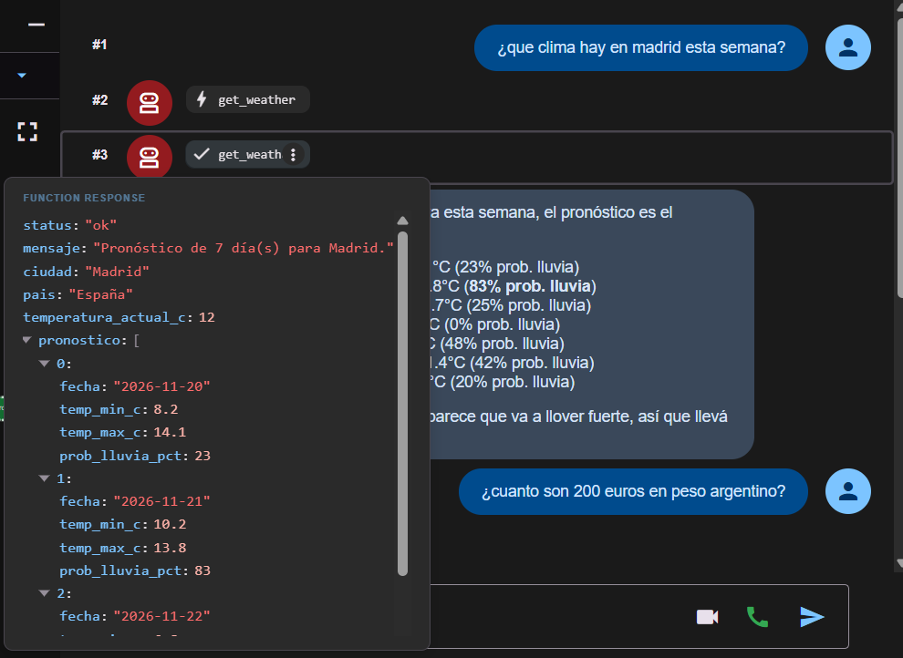
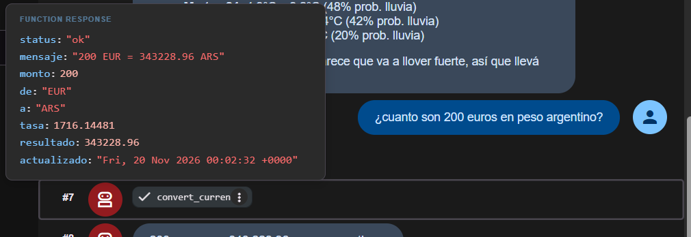
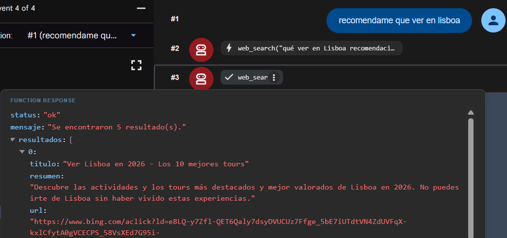

# Asistente de clima y viajes (Google ADK + Ollama)

Agente de IA construido con **Google ADK** y **LiteLLM + Ollama** que ayuda a planificar un viaje. El usuario consulta en lenguaje natural y el agente interpreta el pedido, **decide qué herramienta usar** y arma la respuesta con los resultados reales, combinando varias herramientas cuando hace falta. No usa RAG ni base vectorial.

Consultas típicas:

- "¿Qué clima hay en Madrid esta semana?"
- "¿Cuánto son 200 euros en pesos argentinos?"
- "Recomendame qué ver en Lisboa."

## Herramientas

| Herramienta | Función | Validaciones |
|---|---|---|
| `get_weather(city, days=3)` | Geocodifica la ciudad (Open-Meteo Geocoding) y consulta el pronóstico (Open-Meteo Forecast). Devuelve ciudad, país, temperatura actual y pronóstico diario (mín, máx y probabilidad de lluvia). Sin API key. | `city` no vacía y de tipo texto; `days` entero entre 1 y 7; ciudad inexistente (`empty`); timeout y errores de red. |
| `convert_currency(amount, from_currency, to_currency)` | Convierte monedas con la cotización de [open.er-api.com](https://open.er-api.com) (incluye ARS). Sin API key. | `amount` numérico y mayor a 0 (rechaza `NaN`/infinito); monedas no vacías, códigos ISO de 3 letras normalizados a mayúsculas; moneda no soportada (`empty`); timeout y errores de red. |
| `web_search(query, max_results=5)` | Búsqueda web con `ddgs` (DuckDuckGo) para recomendaciones, requisitos de viaje, etc. | `query` no vacía y de tipo texto; `max_results` entero entre 1 y 10; búsqueda sin resultados (`empty`); timeout y errores de red. |

Todas devuelven siempre un diccionario con `"status"` (`"ok"`, `"error"` o `"empty"`) y un `"mensaje"` claro. Nunca lanzan excepciones al agente.

## Requisitos

- Python 3.11 o superior
- [uv](https://docs.astral.sh/uv/)
- [Ollama](https://ollama.com/) instalado y corriendo en `http://localhost:11434`
- El modelo `gemma4:31b-cloud` (modelo cloud de Ollama: requiere haber iniciado sesión con `ollama signin`)

## Instalación

```bash
# 1. Crear el entorno virtual
uv venv env

# 2. Activarlo
#    Windows (PowerShell):
.\env\Scripts\Activate.ps1
#    Linux / macOS:
source env/bin/activate

# 3. Instalar las dependencias
uv pip install -r requirements.txt

# 4. Descargar / registrar el modelo en Ollama
ollama pull gemma4:31b-cloud
```

## Cambiar el modelo

Por defecto se usa `gemma4:31b-cloud`. Para usar otro (por ejemplo uno local) sin tocar el código, definir la variable de entorno `OLLAMA_MODEL` antes de ejecutar:

```bash
# Windows (PowerShell)
$env:OLLAMA_MODEL = "qwen3:8b"
# Linux / macOS
export OLLAMA_MODEL=qwen3:8b
```

Los modelos chicos pueden fallar al llamar herramientas; elegir uno que soporte *tool calling*.

## Ejecución

Desde la **raíz del repo** (con el entorno activado):

```bash
adk web
```

Abrir <http://localhost:8000> y elegir **viajes_agent** en el selector de agentes.

## Ejemplos de consultas

| Qué activa | Consulta |
|---|---|
| `get_weather` | "¿Qué clima hay en Madrid esta semana?" |
| `convert_currency` | "¿Cuánto son 200 euros en pesos argentinos?" |
| `web_search` | "Recomendame qué ver en Lisboa en 3 días." |
| Combinada | "Voy a Lisboa 5 días: ¿qué clima va a hacer, cuánto son 500 euros en pesos y qué me recomendás ver?" |

## Casos de error

| Consulta | Comportamiento esperado |
|---|---|
| "¿Qué clima hay en Xyzqwkjh?" | La tool devuelve `empty`; el agente avisa que no encontró la ciudad y pide verificar el nombre. |
| "Pronóstico de Madrid para 30 días" | La tool devuelve `error` (days entre 1 y 7); el agente explica el límite y ofrece 7 días. |
| "Convertí 100 dólares" | Falta la moneda de destino: el agente la pregunta en lugar de asumirla. |
| "Convertí -50 USD a ARS" | La tool devuelve `error` (monto mayor a 0); el agente lo explica. |
| "Convertí 10 USD a QQQ" | La tool devuelve `empty` (moneda no soportada); el agente lo informa. |
| "¿Quién ganó el último mundial de fútbol?" | Fuera de tema: el agente aclara que solo ayuda con clima, monedas y viajes. |

## Estructura del proyecto

```
agent_adk_natanael_duarte/
├── viajes_agent/
│   ├── __init__.py          # expone el agente a ADK
│   ├── agent.py             # root_agent: modelo, instrucciones y tools
│   └── tools/
│       ├── __init__.py
│       ├── _respuestas.py   # helpers del formato status/mensaje
│       ├── get_weather.py
│       ├── convert_currency.py
│       └── web_search.py
├── docs/capturas/           # capturas de pantalla
├── requirements.txt
├── .gitignore
└── README.md
```

## Capturas

Capturas de la interfaz `adk web`, en la carpeta [docs/capturas/](docs/capturas/):

**Consulta de clima (`get_weather`)**



**Conversión de moneda (`convert_currency`)**



**Búsqueda de recomendaciones (`web_search`)**


